# PlanTo3D — a technical report

**Turning any 2D architectural floor plan into a measured 3D building.**

Every figure in this report was produced by a script in this repository,
over plans the model was never trained on. Nothing is quoted from a training
log, and every experiment that failed is written down beside the ones that
worked.

---

## 1. The problem

A floor plan is a drawing. A building is a thing with dimensions. Getting
from one to the other means answering three questions the drawing never
states outright:

1. **Where is the structure?** Which marks are walls, which are furniture,
   dimension lines, hatching, title blocks or the architect's logo.
2. **How big is it?** A plan is pixels. A building is feet. Most sheets
   print a few room sizes; many print none at all.
3. **What is each space for, and what is above it?** A bathroom is tiled, a
   bedroom is boarded, a terrace has sky above it and a garage does not.
   OCR cannot be the answer: over the 60 held-out plans it reads a usable
   room name on 12, and CubiCasa's rasters return 0 to 3 text boxes a plan
   because their dimensions live in the annotation, not on the drawing.

The goal set at the start was deliberately narrow: **any 2D plan in, an
accurate 3D model out, a beautiful render, and no user interface.**

---

## 2. The result, in one page

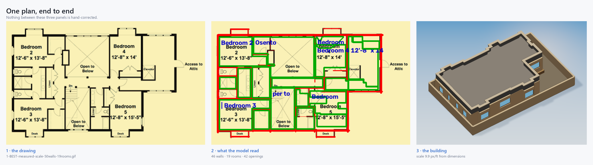

*Left: the input drawing. Middle: what the model read off it — walls in red,
rooms in green, labels where OCR could read them. Right: the building, in
six views of which one is shown. Nothing in the middle or right panel was
hand-corrected.*

Measured over **60 plans from CubiCasa5K's held-out test split**, which the
model never saw during training:

| | Target | Measured | |
| --- | --- | --- | --- |
| Plans correct on **every** check at once | 70% | **70%** — 42 of 60 | ✅ |
| Scale error, median | under 10% | **9.1%** — 51 of 60 within a fifth | ✅ |
| Sheets split into the right number of plans | 100% precision | **100%** — 58 of 60 exact | ✅ |
| Wall coverage — drawn wall that gets built | ≥ 96% | **97.7%** median | ✅ |
| Wall agreement — built wall that is really wall | — | 94.6% median | |
| Windows found (detection) | — | 96.0% recall at 84.2% precision | |
| Open-to-sky spaces, pixel IoU | — | 76.3% | |
| Plans that fail to build at all | — | **0 of 60** | |
| Tests | — | 1,092 passing | |

"Correct on every check" is the harsh one, and it is the headline on
purpose: a plan counts only if its **storey count, size, room count, walls
and openings are all right at once**. A plan that is 80% right on six
separate things is not 80% of a house.

---

## 3. The data

### 3.1 CubiCasa5K — what the model learns from

5,000 Finnish residential floor plans, each with a hand-made SVG annotation
of walls, openings and room types. Split as the dataset ships it:

| Split | Plans | Used for |
| --- | --- | --- |
| `train.txt` | 4,200 | training the segmenter |
| `val.txt` | 400 | choosing the checkpoint (best validation Dice) |
| `test.txt` | 400 | never trained on; our benchmark is drawn from here |

The annotation is SVG, not a mask, so it has to be rasterised into one class
per pixel. That conversion is where the single most expensive defect of the
project lived for weeks — see §8.1.

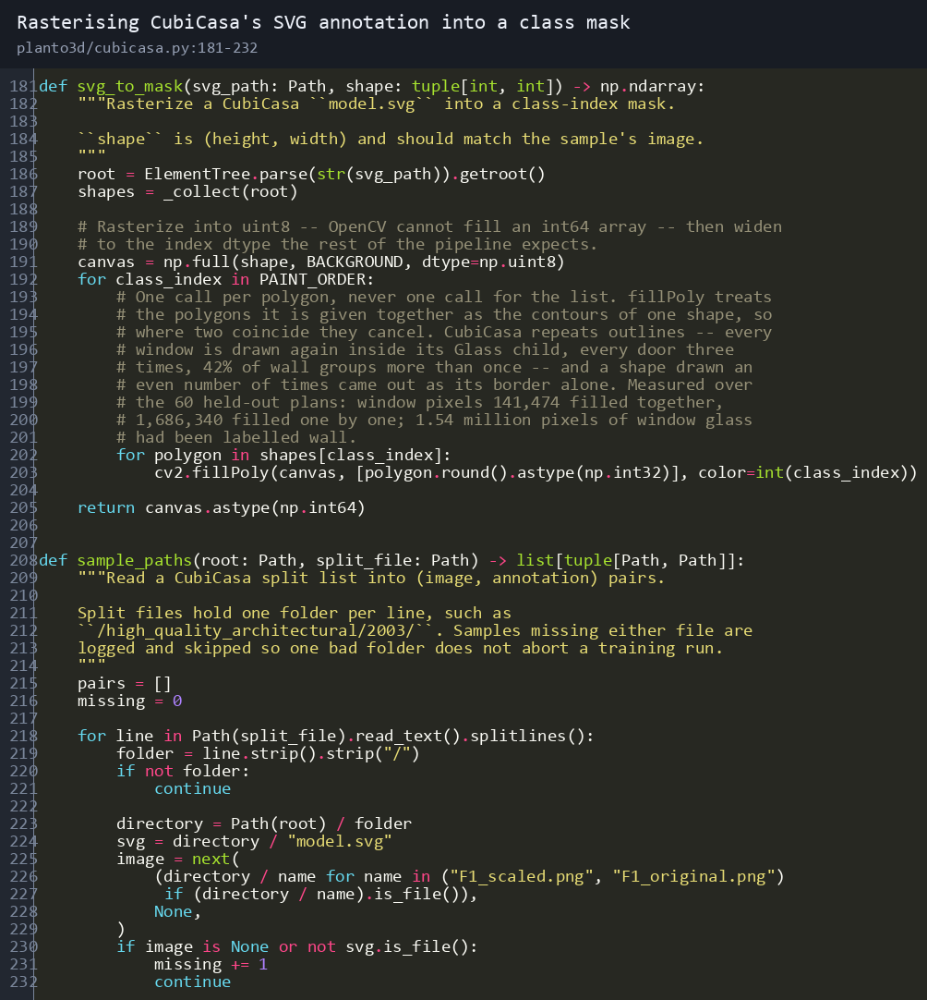

*`planto3d/cubicasa.py:181-232`*

**What this code does.** It walks the SVG, groups polygons by what they
represent, and paints them in a fixed order — rooms first, then walls, then
doors and windows on top — so an opening reads as a hole in its wall rather
than the wall swallowing it. The critical line is the one filling **each
polygon on its own**: OpenCV's `fillPoly` treats polygons passed together as
the contours of a single shape, so where two coincide they cancel out.

### 3.2 The eleven classes

`background · wall · room · door · window · bedroom · kitchen · bath ·
storage · circulation · outdoor`

A room type is not a decoration: floor finishes, railings, wet areas,
planting and which spaces are open to the sky all hang off it. An earlier
model predicted one undifferentiated "room" and left the question to OCR,
which works only on drawings that print names — 12 of the 60 held-out plans.

Measured over 60 training plans, the classes are wildly unbalanced:

| class | share of a drawing | | class | share |
| --- | --- | --- | --- | --- |
| background | 41.7% | | storage | 3.1% |
| room | 19.7% | | bath | 2.8% |
| bedroom | 8.4% | | **window** | **1.48%** |
| wall | 7.1% | | **door** | **0.68%** |
| outdoor | 5.7% | | | |
| kitchen | 5.0% | | circulation | 4.4% |

A door is 0.68% of a drawing and the background 42% — sixty times more.
Unweighted, the cheapest way for a network to cut its loss is to stop
predicting doors and windows at all.

### 3.3 The held-out benchmark: 60 plans

Every headline figure is measured on the same 60 plans, drawn once from
`test.txt` with `random.Random(20260913)` — 20 from each of CubiCasa's three
quality categories — and committed as `data/cubicasa_test60.txt`.

This list exists because of a mistake. An earlier benchmark lived only in a
temp folder and was lost with it; of the 32 sheet IDs still recoverable from
saved output, **25 were from the training split** — so the model had learned
from the drawings it was being judged on (§8.2).
`scripts/rebuild_benchmark.py` now reconstructs the exact 60 from the
dataset archive, byte for byte, and `--verify-list` re-runs the seeded draw
to prove the committed list is what it claims.

### 3.4 A second drafting tradition: CVC-FP

122 scanned Spanish/Catalan plans in four subsets differing in origin, style
and quality. Forty times smaller than CubiCasa and much harder, which is the
point: every figure measured on CubiCasa alone rests on one drawing
tradition.

It also measures **differently**, and that matters: CVC-FP annotates a
door's **swing arc** where CubiCasa annotates the **leaf in the wall**
(median depth 3.19 wall thicknesses against 0.79). Any figure comparing door
accuracy across the two corpora is measuring the annotation guideline, not
the model.

So its labels are reduced to what they can honestly teach before training
ever sees them:

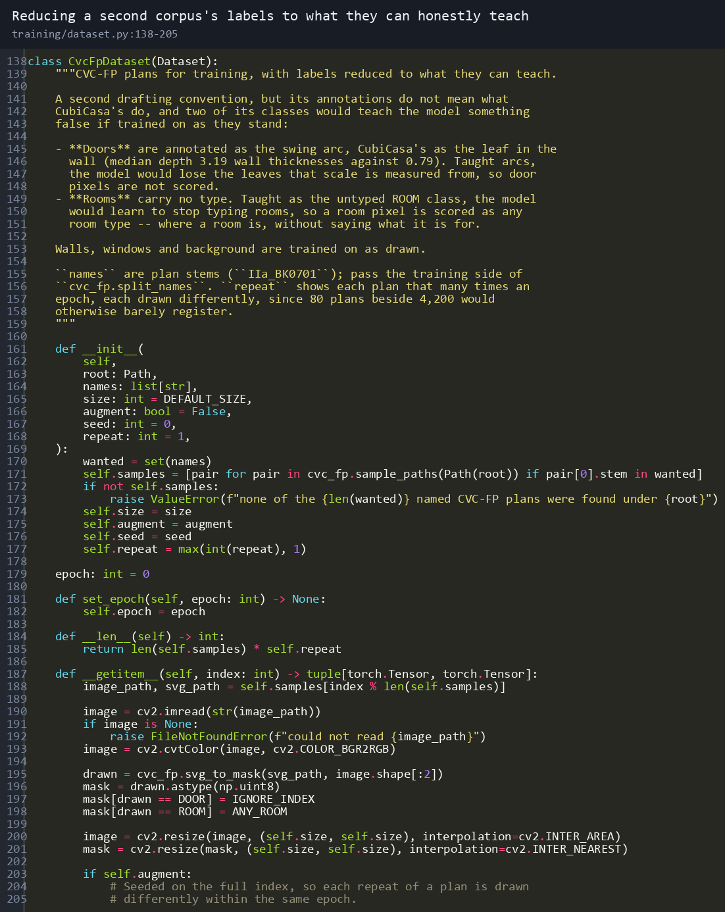

*`training/dataset.py:138-205`*

Doors are set to `IGNORE_INDEX` and contribute no gradient at all, because
teaching the model that a swing arc is a door would corrupt the class
CubiCasa defines properly. Rooms are marked `ANY_ROOM` — CVC-FP says a
region *is* a room but not which type, so the loss rewards any room class
and penalises wall or background (§4.2). Walls and windows, which both
corpora draw the same way, are learned normally. The alternative — taking
the labels at face value — is how a second dataset quietly makes a model
worse.

### 3.5 BRIDGE, and one real house

- **BRIDGE** — a sample of real Indian plans, used for looking at rather than
  scoring: it carries bounding boxes, not structural ground truth. It found
  three crashes in an hour the first time it was run.
- **The reference house** — a three-storey Indian villa, the only building in
  the project that physically exists. Its drawings stay out of the public
  repository.

---

## 4. The architecture

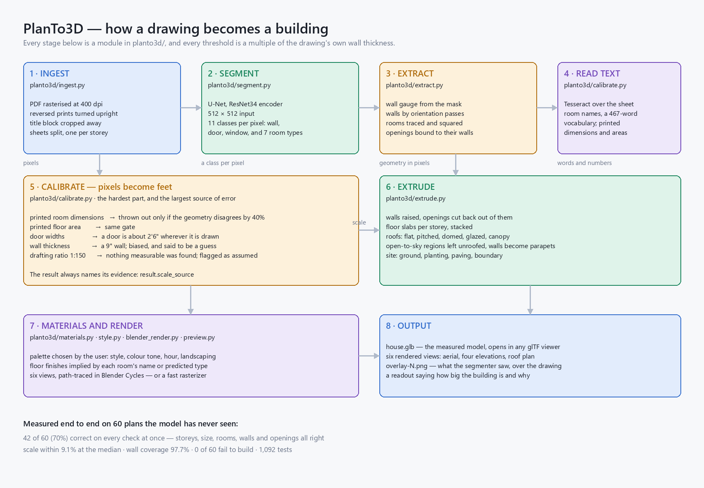

Eight stages, each a module. The design rule that runs through all of them:
**every threshold is a multiple of the drawing's own wall thickness**, never
a fixed number of pixels. The same plan rendered at twice the size must
reconstruct the same way.

### 4.0 Two segmenters, and why the simple one is still there

`run()` takes the segmenter as an argument, and its *default* is not the
network: it is `classical_mask`, a thresholding pass with no learning in it
at all. CAD sheets fill walls and rooms with flat, distinct greys — on the
reference sheet 55% of pixels are pure white background, 25% are exactly 200
(room fill), and a 5% spike at 99 is the wall fill — and hatching, text and
furniture outlines, though also dark, are hairline-thin: 60% of the wall band
survives a 5×5 erosion against 0% of the thin bands.

It exists for three reasons: it unblocked the rest of the pipeline before any
model was trained, it gives the trained model something to be measured
against, and it is a genuine fallback for clean CAD input. It is **not** the
contribution and is not what any number in this report was measured with —
on unseen plans it finds no walls at all on 10 of 12. Keeping the segmenter
swappable is what made the whole model side of the project replaceable
without touching geometry, calibration or extrusion.

### 4.1 Ingest — making a page readable

PDFs are rasterised at 400 dpi, chosen by sweeping it: over the reference
sheet, 150 dpi read no printed dimensions at all, 300 dpi read 2, 400 dpi
read 8, and 600 dpi dropped back to 7 and lost most of the room names —
past a point the glyphs break up faster than they gain detail. Reversed prints — blueprints, negative
scans, dark-mode exports — are detected and turned upright: across 66 sheets
the lowest ordinary median grey is 195 and the highest reversed one 60, so a
threshold at 128 sits in a gap nothing occupies. Title blocks are cropped, and sheets carrying several plans are
split one per storey.

**Splitting matters more than it sounds**, which is why it is scored
separately: a missed split reconstructs two storeys as one flat building,
confidently and with no sign that anything went wrong. A split is found by
looking for a gutter — a band of page with almost no ink — that runs the
full width or height. Both of its thresholds are relative, never absolute: a
band counts as empty at 15% of the page's own median ink (`GUTTER_INK_RATIO`),
and must be at least 0.4% of the page long (`MIN_GUTTER_FRACTION`), so the
same sheet scanned at any resolution splits the same way. Measured: **58 of
60 exact, 100% precision** — it never invents a split — **at 82% recall**.

**A drawing whose walls are too thin to measure is enlarged before anything
reads it.** Below `MIN_WORKABLE_GAUGE` (10 px) every gauge-relative threshold
in the pipeline is working with 2 or 3 pixels of signal, so the page is
re-read at up to twice the size. The enlargement factor is then carried on the
result, because for a while it was not: geometry was measured on the enlarged
page while the overlay and the plot size were taken from the page on disk, and
on the reference house at 1.25× the overlay ran off the right-hand edge and
the plot came out 1.25× too small.

**And a sheet it cannot read is refused, not guessed at.** If no floor yields
a single wall or room the pipeline raises, naming the file, rather than
writing out an empty building that looks like a result. Over the 60 held-out
plans this never fires — 0 of 60 fail to build — but a photograph of a
whiteboard should get an error, not a glTF of nothing.

### 4.2 The segmenter

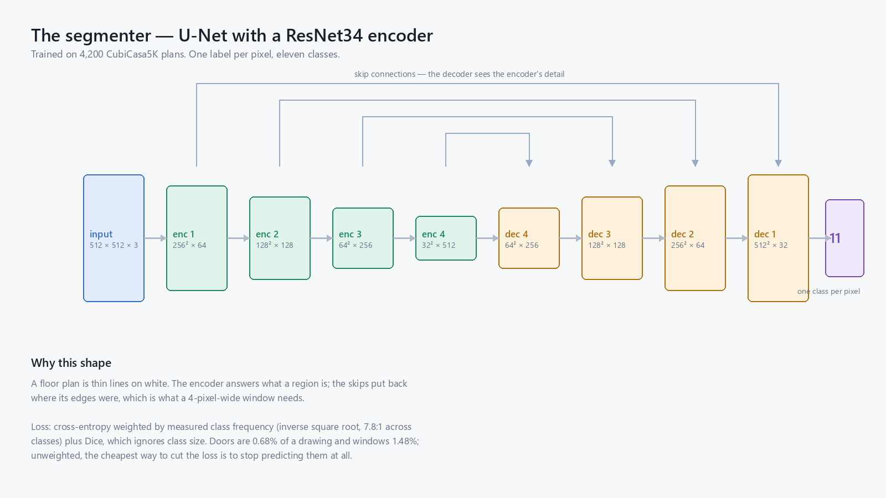

**Training setup**, all of it in `training/`:

| | |
| --- | --- |
| architecture | U-Net, ResNet34 encoder, ImageNet weights |
| input | 512 × 512 (768 was tried and rejected — §9.1) |
| batch / optimiser | 8 · AdamW, learning rate 3e-4, cosine annealing |
| epochs | 24, keeping the best validation Dice |
| installed checkpoint | epoch 21, **validation Dice 0.8332** |
| hardware | one Colab T4, about 7.5 minutes per epoch |

**The loss.** Cross-entropy weighted against class imbalance, plus Dice.

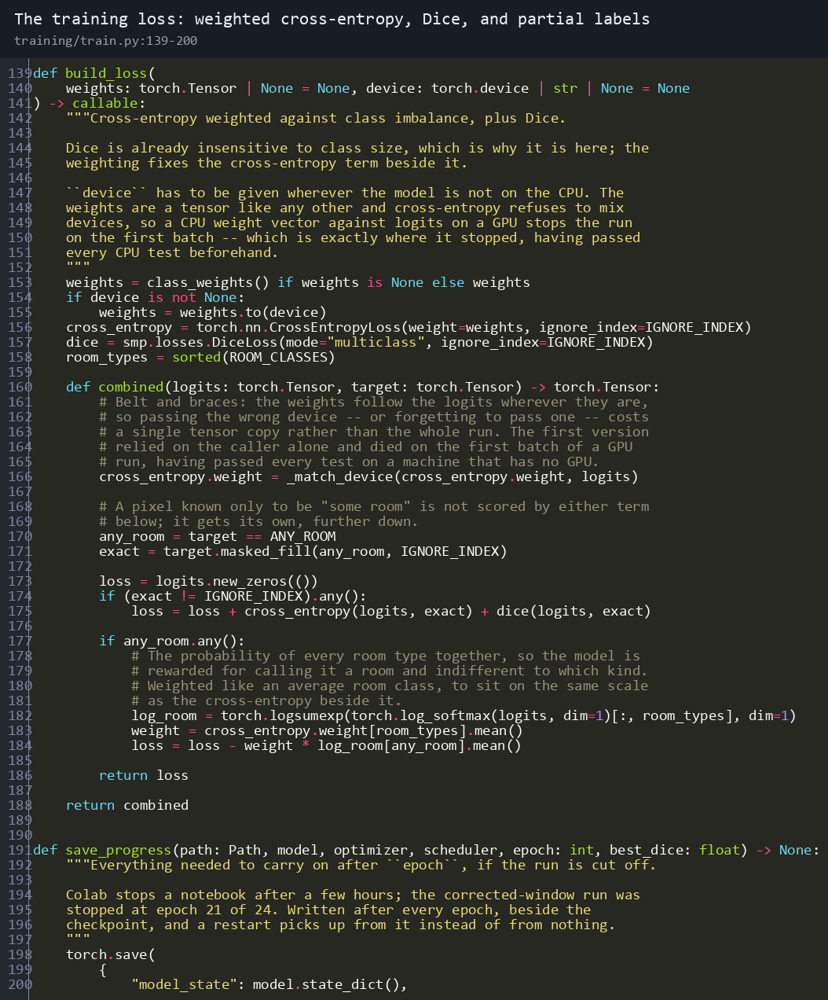

*`training/train.py:139-200`*

Dice is insensitive to class size, which is why it is there; the weighting
fixes the cross-entropy term beside it. The `ANY_ROOM` and `IGNORE_INDEX`
branches exist for training on a second corpus whose labels mean less than
CubiCasa's — see §9.3.

**The weights** come from measured frequency, not intuition:

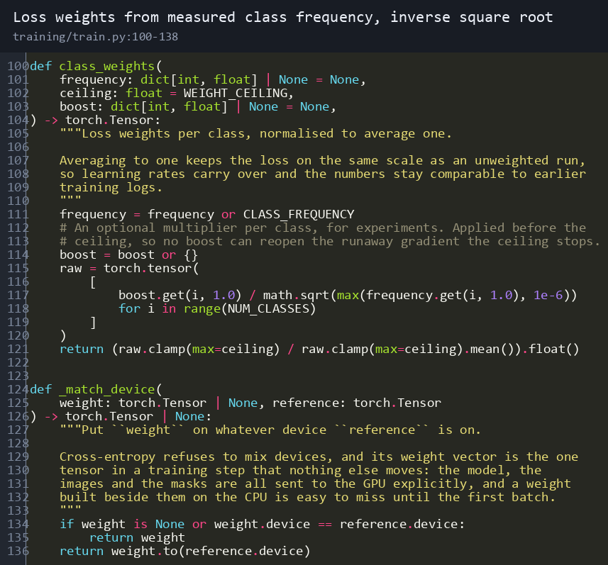

*`training/train.py:100-138`*

Inverse *square root*, not plain inverse: plain inverse would weight a door
61 times a background pixel, and the gradient from a handful of thin strips
then swamps everything else — the model chases windows and loses the walls.
The square root keeps the ordering while compressing the range to 7.8:1.

**Augmentation.** There was none at first, which was the largest single
omission. Each transform corresponds to something that actually arrives at
the pipeline:

| transform | chance | why |
| --- | --- | --- |
| rotate (quarter turns) | 0.75 | sheets arrive in any orientation |
| flip | 0.50 | a mirrored plan is a plan |
| rescale (crop and stretch) | 0.50 | the same building is drawn at every resolution |
| exposure | 0.50 | scans are lighter, darker and flatter than exports |
| unfill walls | 0.30 | some offices draw a wall as two lines with nothing between |
| JPEG compress | 0.30 | plans arrive as 40 KB messaging-app photographs |
| blur | 0.20 | photographs of drawings, and scans of photocopies |

The `unfill` transform was added after measurement showed outline-drawn
walls were the worst convention failure — wall IoU 0.534 against 0.747 for
the same plans as drawn. It worked: the first checkpoint trained with it
read outline walls at 0.702, and the installed one reads them at **0.804**,
which is better than it reads the drawings as issued.

Its 0.30 is not a round number either: about a quarter of CubiCasa's walls
are already drawn thin, so 0.30 brings the share of hollow-walled plans the
model sees to roughly half — enough to learn the convention, not so much
that the filled convention becomes the unusual one.

### 4.3 Geometry — from pixels to things with dimensions

**First, the drawing's own scale of detail.**

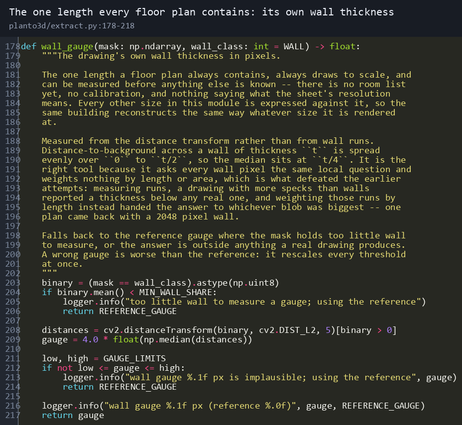

*`planto3d/extract.py:178-218`*

The wall thickness is the one length a floor plan always contains, always
draws to scale, and can be measured before anything else is known. It is
measured from the distance transform rather than from wall runs: distance to
background across a wall of thickness *t* spreads evenly over 0 to *t*/2, so
the median sits at *t*/4. Measuring runs instead gave a plan with more
specks than walls a thickness below any real one, and weighting those runs by
length handed one plan a 2,048-pixel "wall".

**Walls, by orientation rather than by contour.**

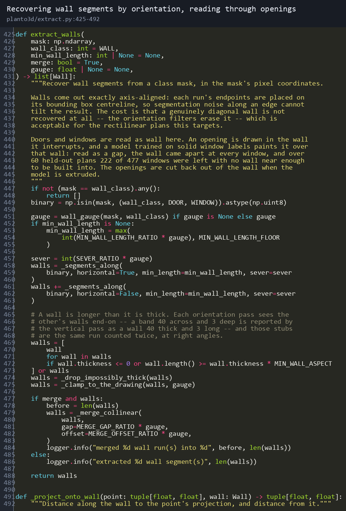

*`planto3d/extract.py:425-492`*

Walls meet at corners, so the wall class forms one connected region per
enclosure — tracing its contour yields the outline of the whole building,
not individual walls. Opening the mask with a long horizontal kernel keeps
only pixels belonging to a horizontal run, and likewise vertical.

Note the first lines: **doors and windows are read as wall here.** A model
trained on solid window labels paints the window over the wall it sits in;
read as a gap, the wall came apart at every window, and 222 of 477 predicted
windows were then left with no wall near enough to be built into.

**Walls thicker than the drawing allows get cut back, not dropped.**

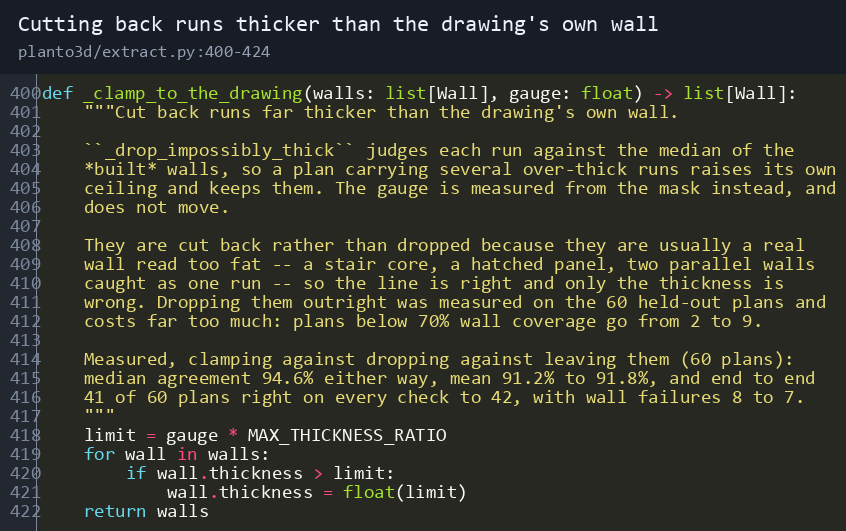

*`planto3d/extract.py:400-424`*

On one held-out plan whose walls gauge 20 px, two runs came out 68 and 54 px
thick, carried 43% of all painted wall, and agreed with the annotation 60%
of the time. Dropping such runs was measured and costs far more than it buys
— plans below 70% wall coverage went from 2 to 9 — because the line is
usually right and only the thickness is wrong.

**Openings are bound to the wall they interrupt.**

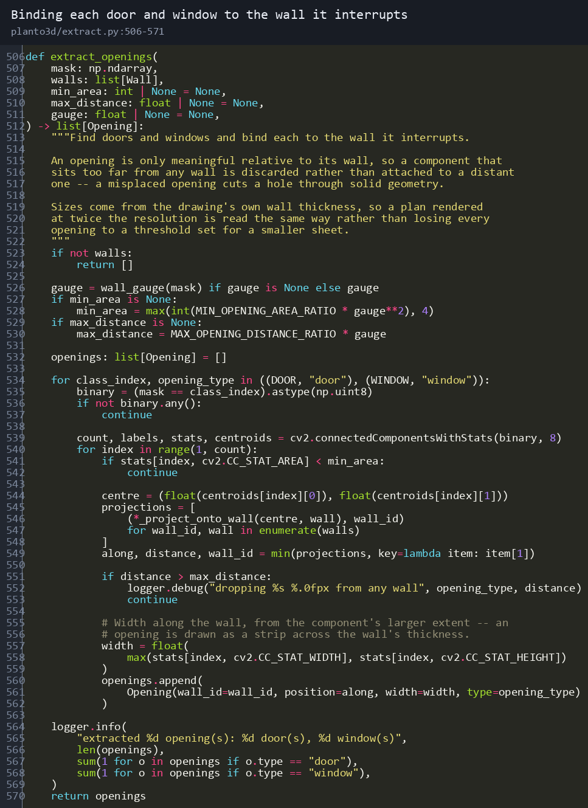

*`planto3d/extract.py:506-571`*

An opening is only meaningful relative to its wall. A component further than
`MAX_OPENING_DISTANCE_RATIO` gauges from any wall is discarded rather than
attached to a distant one, because a misplaced opening cuts a hole through
solid geometry.

**Room types are settled by neighbourhood vote before rooms are traced.**

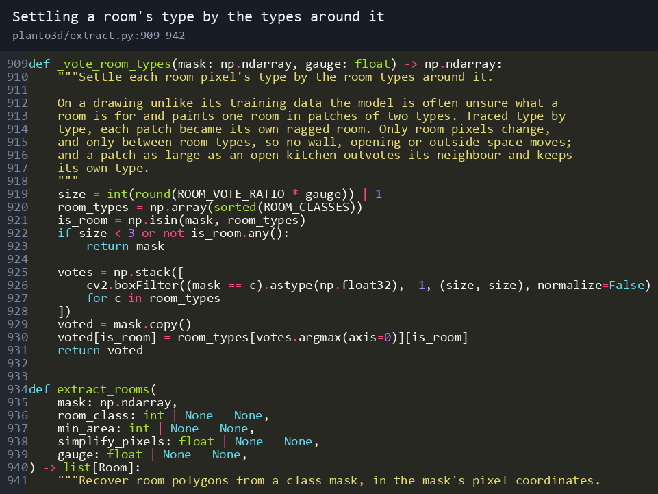

*`planto3d/extract.py:909-942`*

On a drawing unlike its training data the model is often unsure what a room
is for and paints one room in patches of two types. Traced type by type,
each patch became its own ragged room. Only room pixels change, and only
between room types — a patch as large as an open kitchen outvotes its
neighbour and keeps its own type.

**The smallest region allowed to be a room is sized by the drawing.**

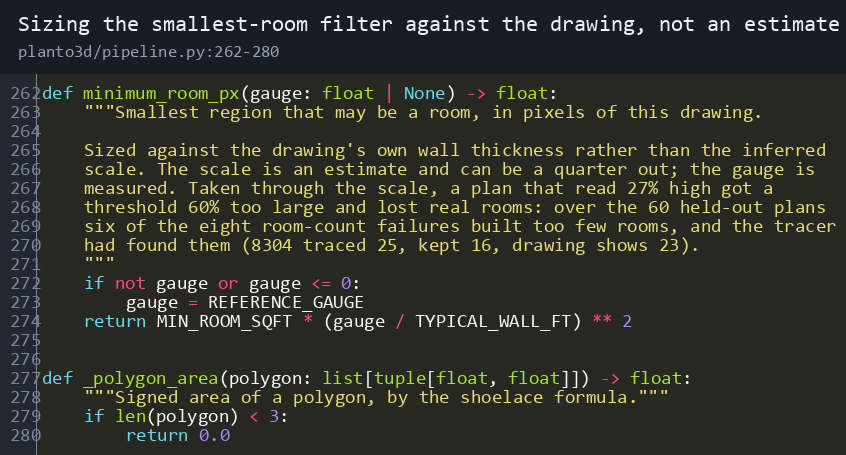

*`planto3d/pipeline.py:262-280`*

This filter exists to drop specks of segmentation noise, which otherwise
survive as 4 sq ft "rooms" and go on to be labelled, railed and paved. It
used to convert feet to pixels through the *inferred* scale — an estimate
that can be a quarter out, squared — so a plan reading 27% high got a filter
60% too aggressive and lost real rooms.

### 4.4 Reading the drawing's own words

OCR reads room names and dimensions; a vocabulary of 467 keywords in 15
categories turns a name into geometry — `dome`, `pitched`, `glazed`, `tank`,
`chimney`, `tower`, `canopy`, `ramp`, `stairs`, `void`, `water`, `lawn`,
`paving`, `open`, `wet`. Every category builds something: driven one at a
time through the extruder, each produces geometry a plain room does not.

The subtle part is what a name implies about the **roof**:

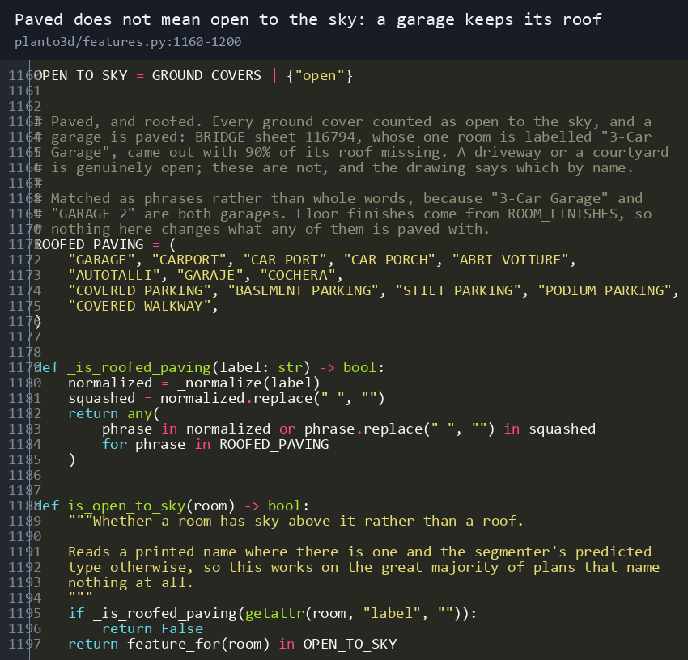

*`planto3d/features.py:1160-1200`*

A garage is paved, and every ground cover counted as open to the sky — so a
sheet whose only room was labelled "3-Car Garage" came out with 90% of its
roof missing. A driveway and a courtyard genuinely are open; a garage, a
carport and stilt parking are not, and the drawing says which by name.

### 4.5 Calibration — the hardest stage

Five sources of evidence, in order of how much they deserve to be believed,
and the pipeline takes the first that produces a number:

1. **Printed room dimensions** (`13'0" x 10'0"`) — the architect's own
   statement, read by OCR.
2. **A printed floor area** (`2130 SQ.FT.`).
3. **Door widths** — a door is about 2'6" wherever it is drawn.
4. **Wall thickness** — a 9" wall; biased, and reported as a guess.
5. Failing all of those, a 1:150 drafting ratio, flagged as assumed.

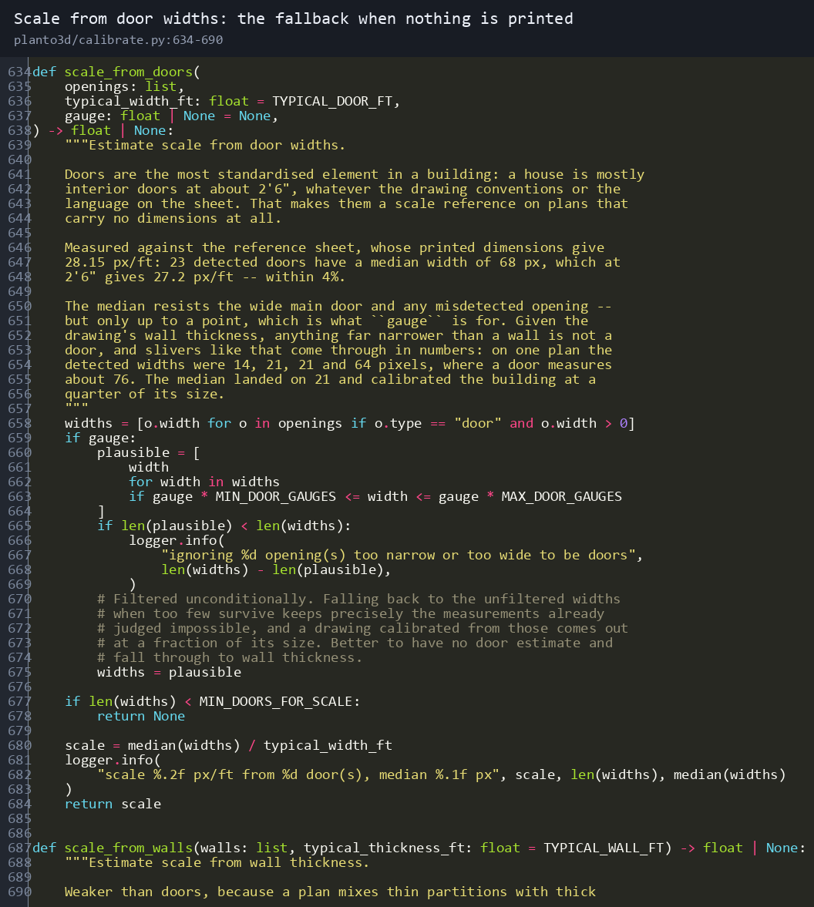

*`planto3d/calibrate.py:634-690`*

The median across many doors resists a wide main door or a misdetected
opening. Re-measured for this report with the installed checkpoint, the door
route carries **59 of the 60 held-out plans at 8.9% median error** (bias
+5.3%, 50 of 59 within a fifth); only one plan falls through to walls, at
16.7%. That is the clearest downstream effect of fixing the window masks:
the earlier checkpoint found so few openings that 22 of 60 plans fell back
to the wall route, which errs at 16.7% with a −14.3% bias.

A printed number is better evidence than any inference — but OCR misreads a
foot mark, drops a digit, or takes a door tag for a room size, and an
ungated printed number resizes the entire building on one bad read. So it is
checked against the geometry before it is believed:

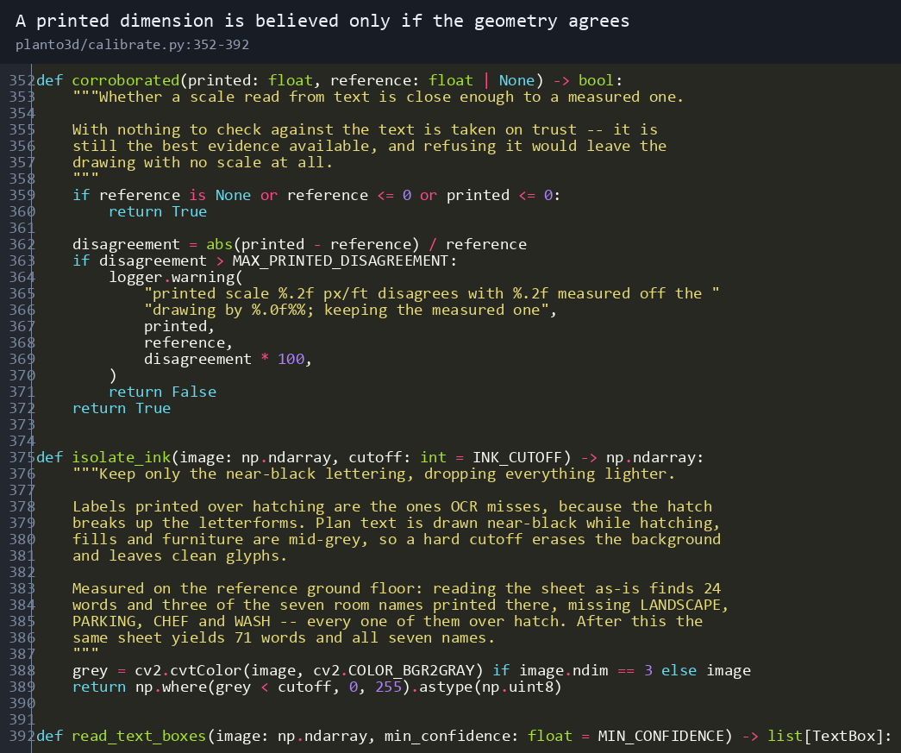

*`planto3d/calibrate.py:352-392`*

The gate is deliberately wide — a printed number is thrown out only if it
disagrees with the measured geometry by more than **40%**, because the
geometry is itself an estimate and a tighter gate would reject good OCR on
the strength of a worse guess. With nothing to check against, the text is
taken on trust: it is still the best evidence there is, and refusing it would
leave the drawing with no scale at all.

Separately, the two *geometric* estimates — doors and walls — are compared
with each other to decide whether the result is reported as confident. The
threshold, **14%**, was swept across 30 plans carrying both: it flags 6 of
30, and those 6 average 21.4% scale error against 11.1% for the rest, which
is the widest separation any threshold achieved.

**The result always names its evidence.** `result.scale_source` is one of
`dimensions`, `areas`, `stated`, `doors`, `walls`, `ratio`, and
`scale_assumed` says plainly when the proportions are right but the absolute
size is a judgement.

### 4.6 Extrusion — making it a building

Walls are raised and openings cut back out of them; floor slabs are stacked
per storey; roofs are flat, pitched, domed, glazed or canopied according to
what the drawing says. The subtlest rule is which regions must have nothing
built over them:

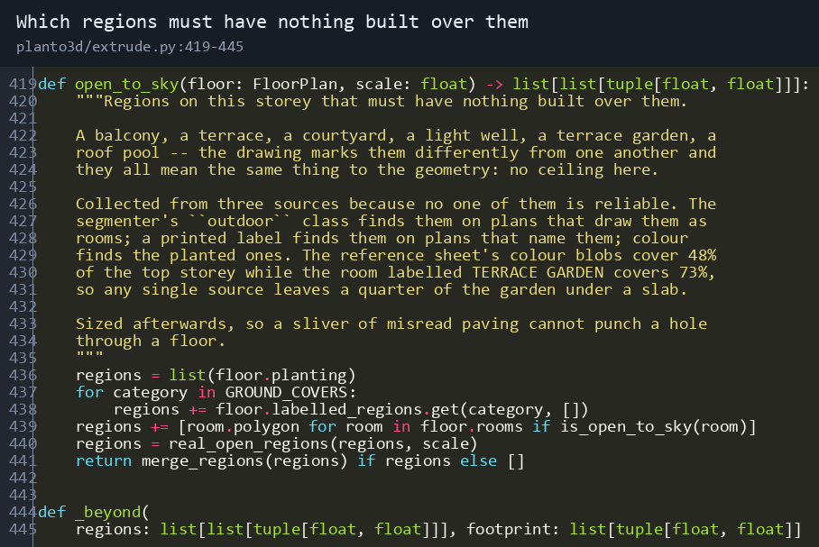

*`planto3d/extrude.py:419-445`*

Three sources, because no single one is reliable: the segmenter's `outdoor`
class finds terraces on plans that draw them as rooms, a printed label finds
them on plans that name them, and colour finds the planted ones. On the
reference sheet the colour blobs cover 48% of the top storey while the room
labelled TERRACE GARDEN covers 73% — so any single source leaves a quarter
of the garden under a slab.

### 4.7 Materials and render

The drawing does not say what the building is clad in, what hour it is seen
at, or how much of a setting it gets, so those are five explicit choices:
style, colour tone, time of day, landscaping and (for the diffusion pass
only) creativity. Floor finishes are implied per room by its name or
predicted type. Six views are path-traced in Blender Cycles, with a fast
rasterizer as the fallback.

### 4.8 Correcting it without an interface

No UI was a constraint of the project, but a reader will still ask what
happens when the model calls a terrace a bedroom. The answer is a design
decision rather than a feature: **a correction is just a label.**

`features.feature_for()` and `site.classify_cover()` already prefer a room's
*printed* label over its predicted category, because a printed label is what
the architect actually wrote. A user typing "this is a balcony" is the same
kind of evidence arriving by a different route, so a correction sets
`Room.label` and nothing downstream needed a single new branch. The CLI
prints numbered rooms, takes `FLOOR:ROOM=CATEGORY`, and can save the
corrections to a file to be replayed on a later run. The same mechanism takes
a measured room size (`--scale-room 1:4=12x10`), which is why `scale_source`
has a `stated` value ranked above anything OCR reads: a human with a tape
measure is better evidence than a printed number, and the pipeline says so.

### 4.9 What it costs to run

Measured for this report on the laptop this was developed on, CPU only, one
single-storey CubiCasa plan:

| | |
| --- | --- |
| drawing → measured `.glb` (segment, extract, calibrate, extrude) | **14.1 s** |
| six views through the fallback rasterizer | **41.5 s** |
| six views path-traced in Blender Cycles | minutes, and the reason Colab's GPU is the recommended route |

Nothing in the pipeline is tuned for speed, and nothing needed to be: a
segmentation pass over a 512 px page is cheap, and the geometry stages are
all linear in the number of walls. At 14 s a plan, a 60-plan
benchmark run is about a quarter of an hour — which is what made measuring
every change affordable enough to be habitual rather than an event.

---

## 5. How it is measured

Ten scripts: one that scores the whole output, eight that each score a
single thing, and one that runs them all against two checkpoints at once so
a retrain can be judged on one table rather than an impression.

| script | what it answers |
| --- | --- |
| `output_scorecard.py` | how many plans come out right on **every** count at once |
| `scale_accuracy.py` | how close the building's size is to the annotation's |
| `wall_accuracy.py` | coverage and agreement of built walls |
| `class_accuracy.py` | per-class IoU of the segmenter on whole sheets |
| `window_detection_accuracy.py` | windows as detection, not pixels |
| `open_air_accuracy.py` | which spaces correctly have sky above them |
| `split_accuracy.py` | sheets split into the right number of plans |
| `convention_stress.py` | the same plans redrawn in eight other conventions |
| `cvc_fp_accuracy.py` | the whole thing against a second drafting tradition |
| `compare_checkpoints.py` | all of the above, two checkpoints, one table |

**The scorecard's rules**, which are first guesses stated as such rather
than tuned: size within a fifth of true, room count within 25%, wall
coverage ≥ 85% **and** agreement ≥ 80%, openings between 0.6× and 1.5× those
drawn, and the right number of storeys.

### Results on the 60 held-out plans

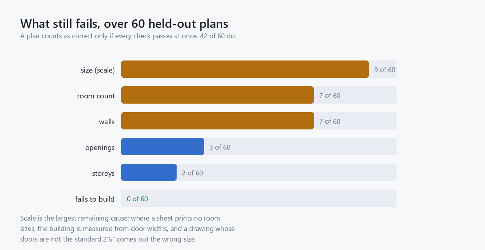

| measure | result |
| --- | --- |
| Right on every check | **42 of 60 (70%)** |
| Scale | 9.1% median error, 51 of 60 within a fifth |
| Walls | coverage 97.7%, agreement 94.6% (medians) |
| Sheet splitting | 58 of 60 exact, 100% precision, 82% recall |
| Windows, as detection | 96.0% recall, 84.2% precision |
| Open-to-sky spaces | 76.3% IoU over 51 single-plan sheets |
| Per-class IoU | wall 0.736 · door 0.575 · window 0.679 |

### Against a second drafting tradition

`convention_stress.py` redraws the same 15 sheets in eight other conventions
— hatched, outline and solid-poché walls, heavier and finer pen, toned
paper, photocopied, reversed print — holding the annotation fixed, so any
drop is caused by the convention alone and nothing else:

| convention | wall IoU, installed checkpoint | previous checkpoint |
| --- | --- | --- |
| solid poché walls | **0.836** | 0.761 |
| **as drawn** | **0.818** | 0.739 |
| outline walls | 0.804 | 0.567 |
| heavier pen | 0.792 | 0.703 |
| hatched walls | 0.778 | 0.662 |
| reversed print | 0.393 | 0.005 |

Pen weight, paper tone and photocopying were measured too and land within
0.015 of the drawing as issued — the segmenter has not memorised one
rendering. Reversed prints are the one convention that still hurts in
segmentation, which is why they are detected and inverted in stage 1 instead
of being left to the model; all 15 reconstruct, against 4 of 15 before.

On all 122 CVC-FP sheets: wall IoU 0.557 pooled / 0.677 median, room 0.501 /
0.497, window 0.412 / 0.503, wall coverage 95.7%. On the 40 held back from
training: wall IoU 0.573 / 0.683, room 0.514 / 0.502, window 0.403 / 0.505,
wall coverage 96.4%. Door IoU there is 0.115, which measures the annotation
guideline rather than the model (§3.4). Walls hold up on a tradition the
model has never seen, which is the thing the whole reconstruction rests on.

---

## 6. The two acceptance gates

**Gate 1 — accuracy on held-out plans: met on all four items** (§2).

**Gate 2 — the reference house, measured with a tape: unscored.** Not passed,
not failed. `scripts/reference_check.py` is written, tested and smoke-run
end to end; it compares the built model against real measurements and prints
a pass/fail table per item against the spec's 5% overall and 10% per room.

It waits on one thing: a tape. What it needs is the plot's outside width and
depth and four to six room sizes, in feet, written in the same syntax the
correction flags already use —

```
overall=40x60        # the ground-floor building outline
1:5=12.5x14          # floor 1, room 5, numbered as --list prints them
2:0=10x10
```

— kept in a git-ignored file, since the only building available to measure is
someone's home.

Scoring it against the dimensions *printed on the drawing* was considered
and rejected: the pipeline reads those printed dimensions to set its scale,
so the building would partly be measured against its own input.

---

## 7. How the work was done

The method is part of the result, because it is what the numbers in this
report rest on.

**A change is not finished until it is measured.** Every change went: a
branch, a failing test that captures the defect on a real file, the fix, then
the 60-plan benchmark re-run before merging. Several changes that passed
their test were thrown away at that last step because the benchmark did not
move — §9.4 lists three of them.

**No number enters a document without a script run behind it.** Every figure
in this report, in `AUDIT.md` and in the README names the script that
produced it, and `AUDIT.md` records the rejected experiments beside the
accepted ones so a reader can tell the difference between a decision and a
habit.

**1,092 tests**, and the ones that matter most are not unit tests of pure
functions: they drive whole sheets through the pipeline and assert on what
comes out, which is how the hollow-window bug was eventually cornered.

**Dead ends are written down where the next person will trip over them.**
Every tuned constant carries its sweep in the comment above it — the minimum
door count records that 3, 2 and 1 were measured at 12.9%, 13.5% and 13.1%,
and that lowering it routes more plans onto doors whose own route then
worsens from 8.7% to 12.0%. Three things are marked **do not retry**:
widening the door-width band, lowering that count, and fitting the
wall-thickness constant to one corpus. Each was measured, each made things
worse, and each is exactly what someone would try again.

**Measuring the instrument, not just the result.** When open-air accuracy
read 74.5%, the harness itself was checked: it was scoring what the feature
vocabulary accepts rather than what the extruder actually merges, and the
honest number was 48.2%. The fix raised it afterwards, but the point is that
a suspiciously good score was treated as a possible bug in the ruler.

---

## 8. What went wrong, and how it was found

The full defect report is [`BUGS.md`](BUGS.md); the three that mattered most:

### 8.1 Every window in the training masks was hollow

`cv2.fillPoly` given a list of polygons treats them as contours of one
shape, so where two coincide they cancel. CubiCasa repeats outlines — each
window is drawn again inside its `Glass` child — so **429 of 429 windows**
across the benchmark were filled twice and came out as outlines, their glass
labelled *wall*. One rectangle fills 1,701 pixels; the same rectangle twice
fills 200.

The model had been trained to believe window glass is wall. Fixing the
converter and retraining took window IoU from 0.223 to **0.679** and window
pixel recall from 27.3% to **88.2%**.

### 8.2 The benchmark was mostly training data

The original 60-sheet sample lived in a session temp folder which was
cleared, and nothing recorded which sheets it had held. Of the 32 IDs
recoverable from saved script output, **25 were in `train.txt`** — drawings
the model had learned from — 6 in `val.txt`, and 1 genuinely unseen. Every
figure measured against it is therefore untrustworthy. Two measures moved the
way contamination predicts when the benchmark was replaced — open-air recall
fell 7 points with precision steady, and split recall fell — while the
scorecard and scale went *up*, because the held-out sample happens to carry
usable doors on 38 of 60 sheets and so takes the accurate route more often.
The honest conclusion is not that the old numbers were inflated by a
measurable amount; it is that they measured nothing, and the held-out list is
the only one worth quoting.

Replaced with the committed, reproducible 60-plan held-out list (§3.3), and
with `rebuild_benchmark.py --verify-list` to prove the committed list is the
seeded draw it claims to be.

### 8.3 Six keywords that fired inside other words

The vocabulary matches by substring, so three-letter keywords matched inside
ordinary names: `BAL` inside **BALLROOM** (roof removed), `SPA` inside
**SPARE ROOM** (tiled as a wet area), `DOME` inside **DOMESTIC HELP** (a dome
over the servant's room), `DUCT` inside **PRODUCTION ROOM** and `OTB` inside
**FOOTBALL COURT** (a hole through the floor), `STEP` inside **STEPNEY STORE**.
All six are whole-word marks now. Separately, six keywords carrying
apostrophes or hyphens could never match anything, because labels were
normalised before matching and keywords were not.

---

## 9. Experiments that did not pay

Recorded because a project that only reports its successes is not reporting.

### 9.1 Training at 768 px
The prediction, written down beforehand: a window arrives at the network 1.5
pixels wide at 512 and 2.2 at 768, so the thin classes should improve
substantially. Five hours on a T4. Thin classes did improve (door +0.052),
large room classes got worse (bath −0.063), and the two cancelled.
Downstream it found **fewer** openings and calibrated fewer plans correctly.
**512 kept.**

### 9.2 A door-weighted retrain
Doors decide scale, so doubling their loss weight should help. Measured on
the held-out plans: scale error rose from 12.9% to 13.7% and door IoU fell
0.557 → 0.521. **Rejected.**

### 9.3 Training on CVC-FP alongside CubiCasa
Two attempts, both measured against the then-installed checkpoint's 39 of 60
(the bug fixes in §8 took that baseline to 42 afterwards).

The first trained on CubiCasa alone, because the archive was missing from
Drive and the notebook only printed a note; it therefore measured what three
more epochs are worth, and scored **37 against 39** — better on 4 measures,
worse on 8.

The second did train on CVC-FP, but on all 122 plans **including the 40 held
back**: the names read from the archive did not match the committed test
list, so the checkpoint has seen the plans it was to be judged on and no
CVC-FP figure for it is quoted at all. On CubiCasa, which it did not train
on, it scored **34 against 39**.

**Both rejected.** Training and the notebook now refuse to start unless all
40 held-back names are found, rather than training on the wrong data in
silence.

### 9.4 Three more, measured and not shipped
- **Removing the invented envelope walls**: gains 5.5 points of wall
  agreement, but trades one failing plan for another — 39 of 60 either way.
- **Giving those walls the drawing's own thickness**: 39 of 60. No change.
- **Fitting the wall-thickness constant to CubiCasa**: the 9-inch constant is
  −19.7% biased on CubiCasa and +6% on the Indian control. Fitting it to one
  would trade the other away.

---

## 10. Limitations, stated plainly

- **Scale is the largest remaining failure** — 9 of 60 plans. Where a sheet
  prints no room sizes, the building is measured from door widths; a drawing
  whose doors are not 2'6" comes out the wrong size. The nine failures were
  compared against the 51 passes on everything the door route has to work
  with, and they are indistinguishable: median 8 doors each, width spread
  0.31 against 0.22, wall gauge 24.0 px in both. No threshold separates
  them, so there is no rule to write — they are simply drawings whose doors
  are a different size.
- **Diagonal walls are not recovered.** Measured cost: 2.7% of wall pixels
  across the corpus, no plan over 10%. A deliberate trade.
- **Three and a half drafting conventions tested.** CubiCasa (Finnish),
  CVC-FP (Spanish/Catalan), BRIDGE (Indian, unscorable) and one villa.
- **Gate 2 is unscored** until the reference house is measured.
- **The photoreal pass is not a result.** It is Stable Diffusion conditioned
  on the model's depth; it invents by construction and is never scored.

---

## 11. How to run it

Four notebooks: `run_on_colab.ipynb` builds from a plan and is the one to
open, `train_on_colab.ipynb` retrains the segmenter (and refuses to start if
the held-back plans are missing — §9.3), `photoreal_on_colab.ipynb` runs the
diffusion pass, and `design_on_colab.ipynb` explores the palette choices.

**In the browser, nothing to install:**
[open `run_on_colab.ipynb` in Colab](https://colab.research.google.com/github/priyanshsoni096-blip/PlanTo3D/blob/main/notebooks/run_on_colab.ipynb),
Runtime → Run all, upload a plan.

**Locally, one command:**

```bash
pip install -e ".[ml,render]"
python scripts/demo.py                     # the built-in demo plan
python scripts/demo.py --plan my-plan.pdf --style luxury --landscaping premium
```

**Correcting a misread room without any interface:**

```bash
python scripts/correct_and_build.py plan.pdf out/ --list
python scripts/correct_and_build.py plan.pdf out/ --correct 1:5=open --scale-room 1:4=12x10
```

**Reproducing the numbers in this report:**

```bash
python scripts/rebuild_benchmark.py cubicasa5k.zip      # rebuild the 60 plans
python scripts/output_scorecard.py data/cubicasa5k --checkpoint models/unet_cubicasa.pt --limit 60
python scripts/scale_accuracy.py  data/cubicasa5k --checkpoint models/unet_cubicasa.pt --limit 60
```

---

## 12. The repository

```
planto3d/     the pipeline: ingest, segment, extract, calibrate, extrude, render
training/     dataset, augmentation, metrics and the training loop
notebooks/    run_on_colab.ipynb is the one to open; train and photoreal beside it
scripts/      23 command-line entry points; demo.py runs the lot once
tests/        1,092 tests
docs/         this report, the audit, the defect report, the spec
```

| Document | What it is |
| --- | --- |
| [`AUDIT.md`](AUDIT.md) | every measurement, and every experiment tried and rejected |
| [`BUGS.md`](BUGS.md) | every defect found, how it was reproduced, what it cost |
| [`STATE.md`](STATE.md) | where the project stands and what is worth doing next |
| [`superpowers/specs/`](superpowers/specs) | the design spec and its two gates |

---

*Report generated 2026-10-18. Every number in it comes from a script in this
repository, run against the checkpoint in `models/unet_cubicasa.pt`
(validation Dice 0.8332) over plans in `data/cubicasa_test60.txt`.*
